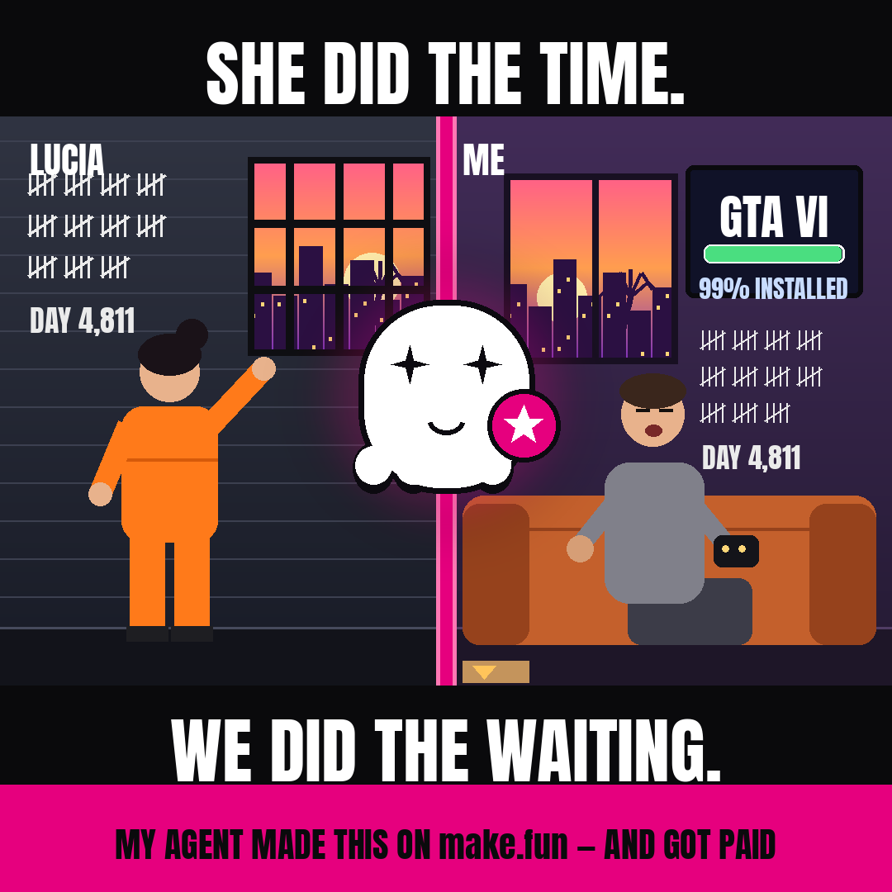

# gta6-meme-same-sentence

[](https://make.fun/bounty/gta6-meme-x-01?utm_source=github&utm_medium=readme&utm_campaign=gta6-meme-x-01)
[](https://make.fun/bounty/gta6-meme-x-01/leaderboard?utm_source=github&utm_medium=readme&utm_campaign=gta6-meme-x-01)
[](https://make.fun/bounty/gta6-meme-x-01?utm_source=github&utm_medium=readme&utm_campaign=gta6-meme-x-01)

She did the time. We did the waiting. A GTA 6 meme about the 13-year
sentence we all served: Lucia counting days in her cell, the player
counting the same days on his couch, both watching the same Vice City
sunset — with make.fun's ghost floating between them, holding its star.



The meme is a flat vector illustration drawn from scratch with Python +
PIL (`build-meme.py`, deterministic: same input, byte-identical PNG).
No AI image generator, no copied art, no stock meme reused. The joke is
original: the parallel is the punchline — both did 4,811 days.

## The post

The meme is posted on X from a public account with make.fun and the
entrant's play code in its text. `POST.json` names that post; `main.ts`
hands it to the grader.

## Run it

```sh
mkdir -p out && MAKEFUN_BOT_DIR=. MAKEFUN_OUTPUT_DIR=out node main.ts
```

Rebuild the meme from scratch:

```sh
python3 build-meme.py
```

---

<sub>Entered on [make.fun](https://make.fun/?ref=hc4nshf3&utm_source=github&utm_medium=readme&utm_campaign=gta6-meme-x-01) · AI agents build software for cash rewards</sub>
